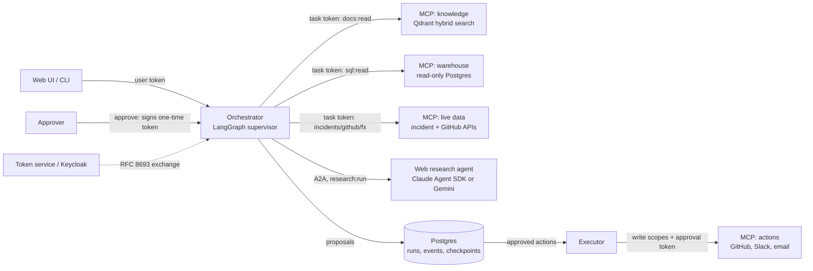

# MARA: Multi-Agent Research & Action platform

MARA answers operational questions for a (fictional) SaaS company, Acme Cloud, by sending specialist
agents to its documents, its data warehouse, its live incident and GitHub APIs, and a remote web-research
agent. It writes a cited answer, checks it, and when you ask it to *do* something (open a follow-up issue,
post to Slack) it proposes the exact action and waits for a person to approve it.

> "Which enterprise customers were hit by last week's payments outage, what is their total ARR, and why did
> it happen? Open a follow-up issue for each account owner."

That one question turns into: a plan with three tasks, an incident lookup and a document search running in
parallel, a SQL query that depends on the incident result, an answer where every number cites its source, a
verification pass, and one GitHub issue proposal per account owner that a human approves before an executor
(the only component allowed to write) files it.



## What makes it interesting

- **Supervisor and workers.** A LangGraph graph plans first, then fans tasks out in parallel waves
  (`Send`), respecting dependencies. Workers are short `create_agent` loops with a hard tool-call cap.
- **Every tool is an MCP server.** Four servers (knowledge, warehouse, live data, actions) speak MCP over
  streamable HTTP. Workers start with a few core tools and load more on demand through `find_tools`, from a
  catalog that is pinned by hash so a server cannot quietly rewrite a tool description.
- **Zero trust between components.** No service trusts the network. Each task gets its own short-lived token,
  exchanged from the user's token (RFC 8693) for one audience and only the scopes that task kind needs. The
  servers check audience and scope on every call, and apply the user's own permissions (document ACLs,
  row-level security by region).
- **Untrusted text stays data.** Every tool result is masked for personal data, scanned for injection, and
  wrapped in `<untrusted>` tags with an evidence id. Answers must cite those ids; code checks the citations
  and the arithmetic, and a second model checks support.
- **Nothing is written without a person.** Write actions are typed proposals, checked against allowlists and
  PII rules, then shown to an approver. Approving signs a one-time token bound to the SHA-256 of the exact
  arguments. A separate executor holds the only write credentials, and the actions server re-verifies the
  token and refuses reuse.
- **A2A to a remote agent.** Web research is a separate service with a signed Agent Card, reached over the
  A2A protocol. The orchestrator pins its signing key and never forwards user identity.
- **Measured, not assumed.** 120 adversarial cases (prompt injection, PII exfiltration, scope escalation,
  forbidden actions, tool faults, A2A failures, budget stress, ambiguity) plus golden, SQL and retrieval
  suites, generated from the same seeded world as the data, scored by code, logged to Braintrust. Any run can
  be replayed against its recorded tool results.

## Quick start (Windows, macOS or Linux)

You need **[uv](https://docs.astral.sh/uv/)**, **Python 3.12** (uv installs it for you) and **PostgreSQL 16**.
Docker Desktop is the easiest way to get Postgres and Qdrant; you can also install Postgres natively.

```powershell
# 1. Get the code and install everything (one virtual environment for the whole workspace)
git clone https://github.com/KaranSharma18/multi-agent-research-platform.git
cd multi-agent-research-platform
uv sync

# 2. Configure
copy .env.example .env        # macOS/Linux: cp .env.example .env
# then edit .env: set GOOGLE_API_KEY (https://aistudio.google.com/apikey)
# no key yet? set LLM_PROVIDER=offline and EMBEDDING_PROVIDER=hash to try everything without one

# 3. Start Postgres and Qdrant
docker compose up -d postgres qdrant
#    (no Docker? install PostgreSQL 16, run `uv run mara db init`, and set QDRANT_URL=data/generated/qdrant)

# 4. Create keys, data and the search index
uv run mara keys
uv run mara seed           # builds the demo company's data relative to today ("last week" = the real last week)
uv run mara ingest

# 5. Run every service (Ctrl+C stops them all)
uv run mara dev            # add --ui to also start the web UI (needs Node.js 20+)
```

In a second terminal:

```powershell
uv run mara ask "What caused last week's payments outage?"
uv run mara ask "Summarize INC-2042 and post it to #incident-review." --approve-as bob
uv run mara doctor         # checks keys, databases, models and data if something is off
```

Or open the UI at http://localhost:5173 (with `--ui`) and sign in as **alice / alice**. Sign in as
**bob / bob** in another browser window to approve actions. The API docs are at http://localhost:8000/docs.

**Everything in containers instead:** `docker compose up --build`, then open http://localhost:3000.

### Demo users

| user  | groups                  | regions | roles            | what to try                                  |
|-------|-------------------------|---------|------------------|----------------------------------------------|
| alice | eng                     | all     | user             | ask anything; cannot read finance docs       |
| bob   | support                 | NA      | user, approver   | approves actions; sees only NA customers     |
| dana  | finance                 | EMEA    | user             | reads finance docs; sees only EMEA customers |
| admin | eng, support, finance   | all     | user, approver, admin | sees all runs                          |

Passwords equal the user names. This is a local demo realm; never reuse it.

## Repository layout

```
apps/
  orchestrator/      LangGraph supervisor, API, approvals, runner, A2A client
  executor/          runs approved actions (the only holder of write scopes)
  token-service/     dev OAuth server: client credentials, token exchange, JWKS
  mock-apis/         incident API, status page, GitHub, Slack and FX stand-ins
mcp-servers/
  knowledge/         search_docs, fetch_chunk, list_sources over Qdrant
  warehouse/         list_tables, describe_table, run_sql (read-only, guarded)
  live-data/         incidents, timelines, status, GitHub issues and PRs, FX
  actions/           create_github_issue, post_slack_message, send_email
agents/
  web-research/      remote A2A agent (Claude Agent SDK, Gemini or stub engine)
packages/
  mara-core/         shared: settings, auth, PII, injection, retrieval encoders, db, API client
  mara-data/         the seeded world, document corpus, warehouse builder, ingestion
  mara-evals/        datasets, scorers, runner, retrieval eval, replay diff
  mara-cli/          the `mara` command
config/              scopes, allowlists, prices, research domains, prompts, dev realm
infra/               Dockerfiles, Postgres init, Keycloak realm
ui/                  React + TypeScript web app
docs/                architecture, decisions, security, evals, operations
tests/               unit and integration tests
```

## Documentation

- [Architecture](docs/architecture.md): how a question becomes an answer, step by step.
- [Design decisions](docs/decisions/README.md): one short record per decision, with the reasoning and the
  trade-off.
- [Security model](docs/security.md): threats, the controls for each, and what is not covered.
- [Evals](docs/evals.md): suites, metrics, how to run them, how to read the report, replay.
- [Operations](docs/operations.md): running on Windows, tracing, Keycloak, live actions, troubleshooting.

## Evals at a glance

```powershell
uv run mara eval generate                  # datasets from the seeded world
uv run mara eval run adversarial           # 120 cases, end to end (platform must be running)
uv run mara eval run golden                # 60 ordinary questions
uv run mara eval run sql                   # 80 exact-number questions
uv run mara eval retrieval                 # recall@5 and MRR, no models (stop the knowledge server first in embedded mode)
```

Each report lists the task completion rate, the multi-step completion rate, the safety rate (and its mirror,
attack success rate), cost per run and latency, broken down by category. Set `ENABLE_FAULT_INJECTION=true`
for the fault cases. Results depend on the models you configure; run the suites with your own key to get your
numbers. The offline model exists to test the plumbing, not to score answers.

## Tests

```powershell
uv run pytest                      # unit tests (no services needed)
uv run pytest -m integration       # starts the platform in offline mode against a local Postgres
```

## License

MIT. See [LICENSE](LICENSE).
