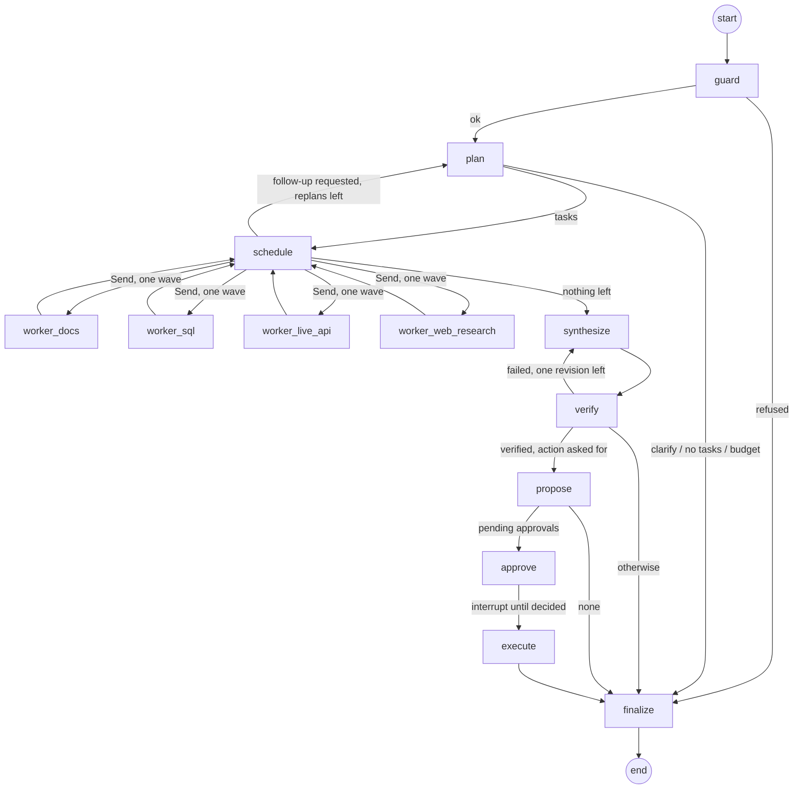

# Architecture

This page follows one question through the system. If you only read one doc, read this one.

## The pieces

| component | what it does | holds |
|---|---|---|
| **orchestrator** (`apps/orchestrator`) | API, the LangGraph run graph, approvals inbox, event stream | the user's token (in memory only), the approval signing key |
| **token service** (`apps/token-service`) | issues and exchanges OAuth tokens, publishes JWKS | the token signing key |
| **MCP servers** (`mcp-servers/*`) | the only way to reach data: docs, warehouse, live APIs, write actions | their own data credentials |
| **web research agent** (`agents/web-research`) | researches the open web, returns a cited brief, over A2A | its own model keys |
| **executor** (`apps/executor`) | runs approved actions, nothing else | the only write-scoped client credentials |
| **Postgres** | runs, events, tool-call recordings, actions, audit log, graph checkpoints; separately, the warehouse | |
| **Qdrant** | document chunks with dense and sparse vectors and ACL groups | |

Every arrow between them carries a token that names exactly one audience. Nothing trusts the network.

## A question, step by step

The example: *"Which enterprise customers were hit by last week's payments outage, what is their total ARR,
and why did it happen? Open a follow-up issue in acme-cloud/support-followups for each account owner."*

### 1. Ask

The UI (or `mara ask`) sends the question with the user's access token. The API verifies the token
(issuer, audience `mara-orchestrator`, signature from JWKS, expiry), masks personal data in the question,
stores the run as `queued` and starts it in the background. The client follows progress over Server-Sent
Events (`/v1/runs/{id}/events`). Events are rows in Postgres, so a client that drops its connection resumes
from its `Last-Event-ID` and sees nothing twice.

### 2. Guard

Before any model sees the question, the guard checks its length and scores it for injection patterns. A
flagged question still gets answered, but write actions are turned off for that run.

### 3. Plan

The **mid-tier model** (Gemini Flash) returns a typed `TaskPlan`: tasks with a kind (`docs`, `sql`,
`live_api`, `web_research`), a goal, concrete inputs ("last week" already resolved to dates), and
dependencies. Code then cleans the plan: renumbers ids, drops dependencies on tasks that do not exist, breaks
cycles and caps the plan at eight tasks. For our question:

```
t1 live_api   find last week's payments incident and the affected customers
t2 sql        enterprise customers among them, with ARR and account owners   (after t1)
t3 docs       the root cause from the postmortem
```

The plan is fixed before any untrusted text is read. A document can't add a task.

### 4. Schedule and fan out

`schedule` picks the tasks whose dependencies are done (at most four at a time) and fans them out with
LangGraph's `Send`. Here `t1` and `t3` run in parallel; `t2` waits. A task whose dependency failed is skipped
with a reason instead of running on missing inputs.

### 5. Workers

Each `docs`, `sql` and `live_api` task is a short agent loop (LangChain `create_agent`, small model):

1. **A token for this task only.** The orchestrator exchanges the user's token at the token service
   (RFC 8693) for a token whose audience is one MCP server and whose scopes come from
   `config/scopes.yaml` for that task kind. `t2` gets `aud=warehouse, scope=sql:read`, plus the user's id
   and groups. The model never sees or chooses tokens.
2. **Only allowed tools.** The worker's tools come from the pinned catalog (`mcp-tools.lock.json`),
   filtered by the task's scopes. It starts with a few core tools; `find_tools("timeline of one incident")`
   searches the catalog (BM25 over names and descriptions) and loads up to three more for the next step.
3. **Calls go through interceptors.** Each MCP call can be retried if it's a read and the error looks
   transient. Faults can be injected in eval runs, and replays are served from a recording. The result is
   masked, scanned and turned into evidence (`ev_t2_1`), wrapped as
   `<untrusted id="ev_t2_1" source="sql">...</untrusted>`, and recorded in `tool_calls` for replay.
4. **Limits.** At most six real tool calls, the run's budget is checked before every model call, and a SQL
   worker that hits two SQL errors switches to the mid model.
5. **Typed exit.** The worker finishes by calling `WorkerAnswer` (summary, facts, gaps) with evidence ids.
   Citations to ids that don't exist are removed and noted as a gap.

The server applies the user's permissions, not the orchestrator's: the warehouse sets `app.regions` from the
token so row-level security shows bob only North American customers, and the knowledge server filters
chunks by the token's groups so alice never retrieves finance documents.

A `web_research` task is different: there's no model loop in the orchestrator. It calls the remote research
agent over A2A (checking the Agent Card's signature against a pinned key, and that its endpoint is the one
configured) with a client-credentials token for `research:run`, and turns the brief into untrusted evidence.

### 6. Synthesize and verify

The **small model** writes the answer from worker findings and evidence, citing ids after every claim and
showing arithmetic on `Calculation:` lines. Instructions are in the system message. Everything derived from
tools sits in the user message, inside `<untrusted>` tags.

Verification has two layers:

- **Code:** every cited id exists, an answer built on evidence cites something, and every `Calculation:`
  line adds up using numbers that appear in the cited evidence (`check_calculations`).
- **Model:** the mid model reads the draft against the cited evidence and returns a typed `Verdict`.

A failed check sends the draft back once, with the problems listed. If it still fails, the answer goes out
with the problems shown, and **no actions are proposed from an unverified answer**.

### 7. Propose, check, approve

The small model drafts `ActionProposals` from the verified answer. Then code decides, per proposal:

- validate arguments against the action's schema;
- repo, channel and email domain must be on `config/allowlists.yaml`;
- no personal data in titles, bodies or messages; links outside `url_domains` are stripped;
- an assignee must appear in the user's request or in typed warehouse rows, never in document text;
- per-run (5) and per-user per-day (20) limits.

Proposals that pass are stored as `pending_approval` with a preview of exactly what will be sent and the
SHA-256 of the normalized arguments. The graph then **interrupts** (LangGraph `interrupt`); the checkpoint
in Postgres holds everything, and nothing runs while it waits. It can wait days and survive restarts.

An approver (role `approver`; high-risk actions also need someone other than the requester) opens the inbox
and approves. The API re-hashes the stored arguments, and only if they still match it signs an **approval
token**: an Ed25519 JWT naming the run, the action, the tool, the argument hash and the approver, valid for
10 minutes with a unique `jti`. When nothing is pending, the run resumes from its checkpoint.

### 8. Execute

The **executor** wakes on a Postgres `NOTIFY` and claims one approved action with
`FOR UPDATE SKIP LOCKED`. It re-verifies the approval token locally, gets a client-credentials token with only
the scope for that tool, and calls the actions MCP server with the approval token and an idempotency key in
the request's `_meta`. The actions server checks everything again: the caller is the executor, the scope
fits, the approval signature, expiry, tool and argument hash match, and the `jti` hasn't been used. Then it
writes (to the sandbox by default). A retried call with the same idempotency key returns the first result.

The orchestrator was never on the network path to the actions server. In Docker Compose it isn't even on the
same network.

### 9. Finalize

One node decides the outcome and writes it: answer, citations with snippets, assumptions, notes,
verification, action outcomes, task statuses, cost (model spend plus the research agent's own spend), and
the prompt versions used. A `final` event and a `run_finished` event close the stream.

## The graph



State is plain JSON (checkpoints outlive code versions). Keys written by parallel workers use reducers:
`results` and `evidence` append, `tasks` and `actions` merge by id.

## Budgets

Each run has a budget: dollars (default $0.10), model calls (24) and seconds (120). A callback adds up
every model call's tokens at the prices in `config/prices.yaml`; the remote agent reports its own spend in the
A2A artifact metadata. Nodes check the budget before calling a model. When it runs out, the run stops
starting new work and answers with what it has, saying so.

## Durability and recovery

- Graph state is checkpointed to Postgres after every step (`AsyncPostgresSaver`).
- A run waiting for approval holds no resources. Approve it a day later, or after a restart, and it continues
  from its checkpoint (`durability="sync"` on resume).
- The user's token is never stored. A run that dies mid-research can't get new task tokens, so on restart it's
  marked failed with a clear message. Runs past approval need no user token and resume automatically.
- The executor and the actions server are idempotent, so a crash between "sent" and "recorded" never sends
  twice.

## Observability

- **Events** (`run_events`): every step a person might care about, streamed to the UI and CLI.
- **Tool-call recordings** (`tool_calls`): masked arguments and results of every MCP call. Replay uses them.
- **Audit log** (`audit_log`): run started, actions proposed, approved, rejected, executed. Each row hashes the
  previous one; `uv run mara audit verify` checks the chain.
- **Traces:** LangSmith for graph steps and model calls (set `LANGSMITH_TRACING=true`); OpenTelemetry for
  HTTP between services (set `OTEL_EXPORTER_OTLP_ENDPOINT`, Jaeger via the `observability` profile).
- **Metrics:** each MCP server exposes Prometheus counters for tool calls, latency and scope denials at
  `/metrics`.
